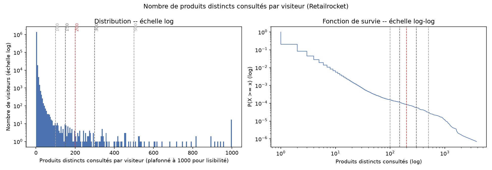

# Limites méthodologiques connues

Ce document rassemble les limites identifiées pendant le développement, module par module. Toutes
sont des résultats légitimes à interpréter et à citer en soutenance, pas des anomalies à cacher —
elles disent quelque chose de réel sur les données.

## RFM (Olist)

**97% des clients Olist n'ont passé qu'une seule commande.** La composante Fréquence du RFM est
donc très peu discriminante (quasi tout le monde a F=1). Conséquence technique : un scoring par
quintiles (`pd.qcut`) est inutilisable pour F — remplacé par un mapping manuel à 3 niveaux
(1 commande / 2 commandes / 3+ commandes). Les segments nécessitant F≥4 (Champions, Fidèles,
À risque) sont donc mécaniquement très petits (0,04% à 0,13% de la base), mais économiquement
cohérents : leur panier moyen est 3× supérieur aux clients mono-achat.

**Validation** : cette limite justifie a posteriori la stratégie B envisagée (RFM comme proxy churn
plutôt que pilier central de l'analyse comportementale sur Olist).

## Market basket (Olist)

**99,25% des commandes livrées ne portent que sur une seule catégorie.** Sur les 18 paires de
catégories les plus fréquentes en compte brut, une seule a un lift ≥ 1 (`bed_bath_table` ↔
`home_confort`, lift = 1,13, association faible). Conclusion analytique : il n'existe quasiment pas
de vrai signal de vente croisée entre catégories sur Olist — un résultat en soi, pas un échec de la
méthode. Les 36 règles générées (support/confidence/lift) sont toutes écrites en base, sans
filtrage arbitraire, pour que le lift documente honnêtement l'absence de signal plutôt que de le
masquer.

## Reco collaborative item-item (Retailrocket)

**79,5% des visiteurs n'ont interagi qu'avec un seul produit** — aucune contribution à la
co-occurrence. Après nettoyage des visiteurs atypiques (>200 produits distincts, probables
bots/crawlers — 118 visiteurs mais des millions de paires mécaniques s'ils sont gardés), la
couverture finale est de **11,6% du catalogue** (27 259 produits sur 235 061 recommandés). C'est un
problème classique de "cold start catalogue" en filtrage collaboratif, pas un défaut
d'implémentation.

**Le seuil de 200 produits, testé — pas juste affirmé (retour de soutenance).** Une première version
du code justifiait ce seuil par une phrase ("118 visiteurs sur 1,4M") sans montrer la distribution
réelle ni vérifier la sensibilité du résultat final à ce choix — à raison, ce n'est pas une
justification. `analytics/analyse_seuil_bot.py` comble ce manque : il trace la distribution complète
du nombre de produits distincts par visiteur et recalcule le pipeline de recommandation en entier
pour 5 seuils candidats (100/150/200/300/500).

Deux constats, honnêtes dans les deux sens :

- **Il n'existe pas de cassure nette dans les données.** La fonction de survie en échelle log-log
  (graphique de droite) est une courbe lisse, sans coude ni rupture de pente marquée autour de 200 —
  la queue de distribution est continue (comportement classique de navigation web à longue traîne),
  pas un mélange visible de deux populations (humains vs bots) séparables objectivement. **200 n'a
  donc pas été "trouvé" par une cassure dans les données — cette affirmation implicite de la v1 était
  inexacte, et est corrigée ici.**
- **Le résultat final est en revanche stable sur toute la plage testée**, ce qui est la vraie question
  posée en soutenance :

  | Seuil | Visiteurs exclus | Paires générées | Couverture catalogue |
  |---:|---:|---:|---:|
  | 100 | 79,549% | 110 662 | 11,37% |
  | 150 | 79,545% | 112 640 | 11,48% |
  | **200** | **79,542%** | **114 481** | **11,60%** |
  | 300 | 79,539% | 117 330 | 11,75% |
  | 500 | 79,537% | 124 515 | 12,07% |

  Sur une plage de seuil ×5 (100 à 500), la couverture catalogue varie de 11,37% à 12,07% (+0,7 point,
  +6% relatif) et le volume de recommandations de +12,5% — une variation graduelle et monotone, sans
  saut. Le taux de visiteurs exclus, lui, ne bouge quasiment pas (79,54% ± 0,01 point) : l'essentiel de
  l'exclusion vient du plancher `MIN_ITEMS_PER_VISITOR = 2` (visiteurs à un seul produit, sans aucune
  contribution possible à une co-occurrence), pas de la borne haute testée ici.

**Conclusion assumée** : 200 est un choix raisonnable *dans une plage robuste* (le résultat ne
dépend pas fortement de la valeur exacte entre 100 et 500), mais ce n'est pas une valeur
scientifiquement optimale dérivée d'une cassure objective — parce que cette cassure n'existe pas dans
ces données. Tableau complet reproductible : `docs/assets/seuil_bot_sensibilite.csv` (généré par
`analytics/analyse_seuil_bot.py`, à relancer si le dataset change).

## Scoring churn

**Biais de sur-apprentissage identifié et corrigé** : scorer tous les clients avec un modèle
entraîné sur ces mêmes clients donne des probabilités in-sample artificiellement extrêmes (proches
de 0/1 — répartition initiale 34 660 low / 890 medium / 14 450 high, quasi bimodale). Corrigé par
validation croisée (`cross_val_predict`, 5 plis) : chaque client est scoré par un modèle qui ne l'a
pas vu à l'entraînement, donnant une répartition honnête (30 455 / 7 717 / 11 828) cohérente avec
l'AUC mesuré (0,92). Le modèle est bien calibré : taux de churn réel de 5,2% (low) à 25,4% (medium)
à 92,2% (high).

## Vue client 360° / proxy de risque de non-réachat (Olist)

Module ajouté en réponse à une remarque de l'encadrant demandant de "fusionner les données" — voir
[architecture.md](architecture.md) pour l'explication complète de pourquoi une fusion brute des 3
datasets est impossible, et ce qui a été fait à la place (fusion des **résultats** d'analyse sur les
clients Olist, pas des lignes brutes des 3 sources).

**Ce n'est pas un vrai churn.** Il n'existe aucune étiquette de départ client réelle pour les clients
Olist (contrairement au dataset churn labellisé). Le "risque" calculé est un **proxy** entièrement
fabriqué à partir du comportement d'achat observé : un client est classé "à risque" s'il n'a pas
racheté dans une fenêtre de 126 jours après sa première commande. Ce chiffre n'est **pas choisi au
hasard** : il correspond au 75ᵉ percentile du délai de réachat réellement observé chez les 2 801
clients Olist ayant effectivement racheté (médiane 29 jours, moyenne 81 jours, tirée vers le haut
par une distribution très étalée) — 75% des réachats réels ont lieu dans cette fenêtre.

**Déséquilibre des classes, avec les vrais chiffres** : sur 67 993 clients disposant d'assez de
recul pour être évalués (les 25 365 clients trop récents sont exclus de l'entraînement, pas
mal-étiquetés), la répartition est de **1 859 "retenus" (2,7%) contre 66 134 "à risque" (97,3%)** —
un déséquilibre encore plus extrême que celui du dataset churn original (71%/29%). Géré avec les
mêmes techniques que le scoring churn (`class_weight='balanced'`, validation croisée à 5 plis pour
un scoring honnête), mais avec les chiffres propres à Olist, pas ceux du dataset churn.

**Résultat négatif, assumé, documenté — et re-testé après une revue critique (v2).** La première
version (v1) testait une seule configuration (Random Forest, features incluant la note de l'avis et
le délai de livraison) et concluait à un ROC-AUC de 0,57 après un seul essai — insuffisant pour
affirmer "aucun signal n'existe" avec confiance. Version corrigée (v2) :

- **Retrait des features connues après coup** : la note de l'avis et le délai de livraison ne sont
  connus que des semaines après le 1er achat, donc inutilisables pour un usage marketing réel
  ("détecter tôt"). Ne restent que des variables connues au moment même du 1er achat (montant, frais
  de port, mode de paiement, catégorie, état).
- **3 configurations comparées** au lieu d'une seule : Random Forest avec/sans `class_weight`, et
  Gradient Boosting (`HistGradientBoostingClassifier`). Résultat : Gradient Boosting fait légèrement
  mieux (ROC-AUC test = 0,586, contre 0,564 et 0,557 pour les deux Random Forest) — `class_weight`
  aide un peu (0,564 > 0,557), mais l'écart entre algorithmes reste faible. Score honnête final
  (validation croisée, Gradient Boosting) : **ROC-AUC = 0,58**.
- Le diagnostic reste le même malgré la comparaison plus rigoureuse : pouvoir prédictif quasi nul.
  Interprétation inchangée et renforcée : contrairement au churn "classique" (souvent lié à des
  signaux comportementaux récurrents — appels SAV, abandon panier répété), le réachat sur une
  marketplace comme Olist dépend probablement de facteurs extérieurs à une transaction isolée
  (besoin du produit, concurrence, etc.), non capturés par les données disponibles. Cohérent avec les
  deux autres limites déjà documentées ci-dessus (RFM mono-achat, absence de vente croisée).

Le module est déployé (dashboard, page "Vue client 360°") avec un avertissement de fiabilité visible
en permanence — **calculé dynamiquement** depuis `analytics.model_metrics_history` (pas une valeur
codée en dur), donc il resterait juste même après un futur recalcul. La valeur pédagogique du
résultat négatif, mesuré avec plusieurs configurations plutôt qu'une seule, est jugée supérieure à
celle d'un module "qui a l'air de marcher" sans base réelle.

**Recommandation de catégorie — repli et sa limite.** La v1 ne recommandait une catégorie qu'à 9,9%
des clients (règle d'association à lift ≥ 1 requise). Un repli a été ajouté (v2) : à défaut de règle,
recommander la catégorie la plus vendue globalement (`bed_bath_table`) — la couverture passe à 98,6%.
**Limite de ce repli, assumée** : `bed_bath_table` est à la fois l'unique cible de règle réelle et la
catégorie la plus vendue globalement, donc 90% des recommandations affichées sont en réalité la même
suggestion générique ("achetez ce qui est populaire"), pas une vraie personnalisation. Le dashboard
distingue visuellement les deux cas (`(règle)` avec le lift réel vs `(populaire)` sans lift) pour ne
pas laisser croire à une personnalisation qui n'existe pas.

**Historique des métriques.** Toutes les métriques de comparaison (v1 et v2, RF et Gradient Boosting,
scores test et hors-échantillon) sont journalisées dans `analytics.model_metrics_history`
(append-only, jamais vidé contrairement aux autres tables `analytics.*`) — fondation pour un futur
suivi de dérive dans le temps, absente jusqu'ici du projet.

## Analyse de sentiment (deep learning)

**Pas d'étiquette de sentiment annotée par un humain dans ce dataset.** Le label est dérivé par
apprentissage faible ("weak supervision") depuis la note laissée par le client (1-2★→négatif,
3★→neutre, 4-5★→positif) : le modèle apprend donc à prédire la note à partir du texte, utilisé
comme proxy du sentiment — une pratique reconnue mais à présenter comme telle.

Résultats (validation croisée, 5 plis) : très bon sur négatif (F1=0,79) et positif (F1=0,89),
nettement plus faible sur neutre (F1=0,30, précision 0,22). C'est un résultat attendu et documenté
dans la littérature : les avis 3★ sont intrinsèquement ambigus en texte (souvent proches d'un avis
2★ ou 4★ selon le rédacteur), pas un signe d'implémentation défaillante.

## Détection d'anomalies

Le détecteur (`/analytics/anomalies`) compare la **période la plus récente** à l'historique
(z-score), comme une alerte de monitoring en production. Il ne scanne pas rétroactivement tout
l'historique : un pic ponctuel déjà passé (ex. le pic à 68,6% d'avis négatifs identifié en décembre
2016 dans la tendance sentiment) ne sera pas signalé s'il n'est plus la période la plus récente.
Portée volontairement limitée à "l'état actuel est-il anormal", pas à une recherche exhaustive
d'anomalies passées.

## Plan d'action marketing par client

Le facteur de risque retenu par client est une **heuristique** (z-score de ses variables
comportementales, pondéré par l'importance globale de la variable dans le modèle), pas un
diagnostic causal. Elle identifie la variable où le client s'écarte le plus de la moyenne de la
population parmi 8 dimensions connues pour peser sur le churn — utile pour prioriser une action,
pas une preuve que cette variable *cause* le départ du client.

## Recalcul à la demande

Suivi des jobs en mémoire dans le processus API (voir [architecture.md](architecture.md)) : ne
survit pas à un redémarrage de l'API, incompatible avec plusieurs workers uvicorn. Adapté à la
portée d'un projet à instance unique, pas à une mise en production telle quelle.

**Versioning et rollback des modèles (retour de soutenance).** Avant `analytics/model_registry.py`,
un recalcul à la demande écrasait toujours `analytics.churn_scores` / `analytics.customer_360` en
place, sans comparaison avec la version en production ni possibilité de revenir en arrière — un
modèle moins bon pouvait silencieusement remplacer un meilleur. Corrigé : une nouvelle version n'est
promue que si sa métrique (AUC hors échantillon) n'est pas inférieure de plus de 0,01 à la version
active ; sinon, la version active est conservée et le résultat rejeté est écrit à part
(`*_candidate`) pour inspection plutôt que jeté silencieusement. Un rollback d'**un seul niveau**
est possible depuis la page Administration (table `*_previous`, sauvegardée à chaque promotion).
Limite assumée : ce n'est pas un historique complet versionné (type MLflow) — proportionné à
l'échelle du projet ; l'historique COMPLET des métriques de chaque exécution (promue ou non), lui,
reste append-only et jamais purgé dans `analytics.model_metrics_history`.

## RGPD — droit à l'oubli

Voir [rgpd.md](rgpd.md#droit-à-loubli--anonymisation-plutôt-que-suppression-complète) : la
justification de l'anonymisation par article du RGPD (17(3)(d), 89(1)) a été explicitée (retour de
soutenance), et une affirmation trop forte de la version précédente ("la ligne cesse d'être une
donnée personnelle") a été corrigée en distinguant anonymisation démontrée et pseudonymisation —
sans analyse de k-anonymat menée sur les attributs comportementaux restants à ce stade.
