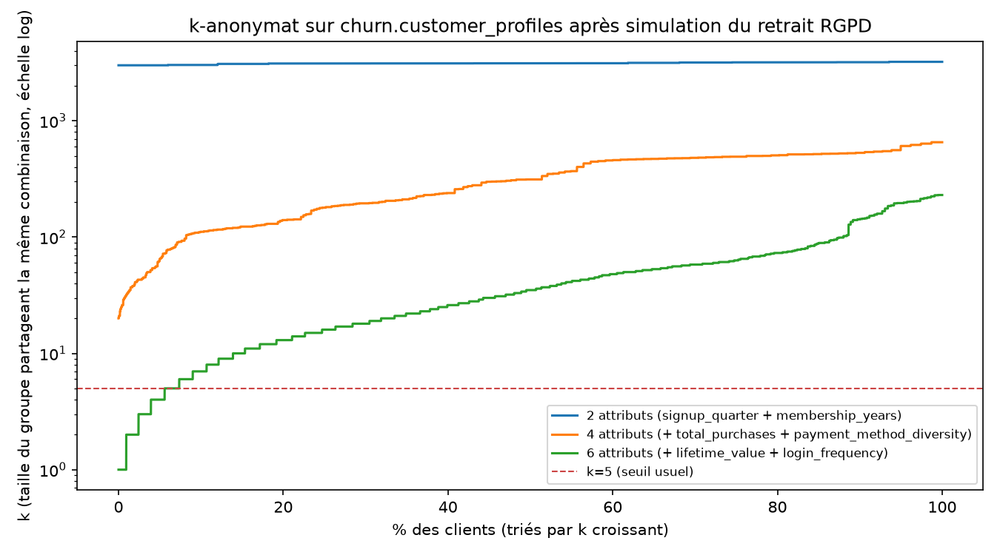

# Approche RGPD

## Périmètre

J'ai implémenté le patron RGPD (droit d'accès, droit à l'oubli, traçabilité) sur le schéma
**`churn`** en premier (une seule table, PII évidentes : âge, genre, ville). Je ne l'ai pas encore
répliqué sur `olist` (via `customer_unique_id`) ni `retailrocket` (via `visitor_id`) — prochaine
étape si le temps me le permet, en réutilisant le même patron (voir `api/routers/rgpd.py`).

## Droit d'accès et de portabilité

`GET /rgpd/churn/{customer_id}/export` (admin uniquement) renvoie l'intégralité de la ligne
`churn.customer_profiles` correspondante en JSON.

## Droit à l'oubli : anonymisation plutôt que suppression complète

`DELETE /rgpd/churn/{customer_id}` retire les champs identifiants (`age`, `gender`, `country`,
`city` → `NULL`) plutôt que de supprimer la ligne entièrement.

### Base légale explicite (retour de soutenance : mon jury m'a fait remarquer que ce choix devait
### être rattaché au texte RGPD, pas seulement présenté comme un arbitrage d'ingénierie)

Le RGPD prévoit lui-même une exception au droit à l'oubli, pas seulement un principe général
d'"intégrité des statistiques" que j'invoquerais de façon informelle :

- **Article 17(1)** pose le droit à l'effacement ("droit à l'oubli").
- **Article 17(3)(d)** en exclut explicitement les traitements *"à des fins archivistiques dans
  l'intérêt public, à des fins de recherche scientifique ou historique ou à des fins statistiques
  [...] dans la mesure où le droit visé au paragraphe 1 est susceptible de rendre impossible ou de
  compromettre gravement la réalisation des objectifs dudit traitement"*. C'est exactement mon cas
  ici : les scores de risque que j'ai déjà calculés (`analytics.churn_scores`) et les métriques
  agrégées du dashboard dépendent de l'intégrité référentielle avec `churn.customer_profiles` — une
  suppression complète casserait cette clé étrangère et fausserait rétroactivement des statistiques
  déjà publiées à d'autres utilisateurs.
- **Article 89(1)**, auquel l'article 17(3)(d) renvoie, conditionne cette exception à des
  *"garanties appropriées [...], en particulier [...] la pseudonymisation"* — pas à l'absence de
  toute garantie. Retirer les identifiants directs (`age`, `gender`, `country`, `city`) au moment de
  la demande d'effacement, c'est justement la garantie que j'apporte : c'est ma mise en œuvre
  concrète de l'article 89(1), pas un choix technique déconnecté du texte.

### Anonymisation ou pseudonymisation ? Une distinction que je ne dois pas trancher par excès de confiance

Dans une version précédente de cette documentation, j'affirmais que la ligne *"cesse d'être une
donnée personnelle au sens RGPD"* après ce traitement — affirmation trop forte, que je corrige ici.
Le RGPD (considérant 26) et la doctrine de la CNIL distinguent :

- une donnée **anonymisée** : le risque de réidentification est négligeable *de façon démontrée*
  (aucun moyen raisonnable de rattacher la donnée à une personne) → sort entièrement du champ du
  RGPD ;
- une donnée **pseudonymisée** : des identifiants directs sont retirés, mais un identifiant stable
  subsiste (ici `customer_id`) et/ou une combinaison d'attributs restants pourrait, en théorie,
  permettre un ré-appariement (singling-out) → **reste une donnée personnelle** au sens du RGPD,
  simplement soumise à un traitement plus protecteur.

Ce que je fais avec `DELETE /rgpd/churn/{customer_id}` est, honnêtement, plus proche de la
**seconde** catégorie : je conserve `customer_id` (clé technique nécessaire à l'intégrité
référentielle), et une combinaison d'attributs comportementaux restants pourrait, en théorie,
permettre un ré-appariement. Je ne fonde donc pas ma base légale sur l'affirmation "ce n'est plus
une donnée personnelle", mais bien sur l'exception explicite de l'article 17(3)(d) + les garanties
de l'article 89(1) — un traitement qui **reste** dans le périmètre du RGPD mais que le RGPD
autorise lui-même à poursuivre, aux conditions des garanties que j'apporte ici.

### Analyse de k-anonymat sur les attributs restants (retour de soutenance)

Je n'avais mené, dans une version précédente, aucune analyse de k-anonymat pour vérifier si les
attributs comportementaux qui restent après anonymisation (`lifetime_value`, `login_frequency`,
`total_purchases`, etc.) permettraient malgré tout, combinés, de ré-identifier un client. Je l'ai
fait avec `analytics/analyse_k_anonymat.py` : pour chaque client, je calcule k, la taille du groupe
de clients qui partagent exactement la même combinaison généralisée (par quartiles) d'attributs —
k=1 signifie que la combinaison identifie un client unique.

Résultat honnête, dans les deux sens :

| Quasi-identifiants combinés | k minimum | % clients avec k≤1 (uniques) | % clients avec k≤5 | % clients avec k≤10 |
|---|---:|---:|---:|---:|
| 2 (trimestre d'inscription + ancienneté) | 3 000 | 0% | 0% | 0% |
| 4 (+ nb d'achats + diversité de paiement) | 20 | 0% | 0% | 0% |
| 6 (+ valeur vie client + fréquence de connexion) | **1** | **0,93%** | 7,36% | 15,35% |

Avec seulement 2 à 4 attributs comportementaux, l'anonymisation est solide (groupes de plusieurs
centaines à plusieurs milliers de clients). Mais avec 6 attributs combinés — un adversaire qui
connaîtrait, par exemple, la valeur vie client et la fréquence de connexion approximatives d'un
client via une autre source — **0,93% des clients deviennent uniquement identifiables** (k=1) par
cette seule combinaison, et 15,35% tombent sous le seuil usuel de k=10. C'est l'effet classique de
dégradation du k-anonymat : chaque attribut supplémentaire, même anodin pris isolément, réduit
fortement la taille des groupes.

**Conclusion que j'assume** : mon anonymisation RGPD protège bien contre une ré-identification
par un petit nombre d'attributs, mais pas contre un adversaire qui combinerait plusieurs attributs
comportementaux précis. Ce n'est donc pas une anonymisation garantie au sens strict (voir
distinction ci-dessus), ce qui confirme et chiffre ce que j'annonçais déjà : je m'appuie sur
l'exception légale de l'article 17(3)(d), pas sur l'affirmation que la donnée serait devenue
anonyme. Tableau complet reproductible : `docs/assets/k_anonymat_resultats.csv` (généré par
`analytics/analyse_k_anonymat.py`, à relancer si le dataset change).

## Traçabilité (principe de responsabilité / accountability)

Je journalise chaque export et chaque anonymisation dans `app.rgpd_audit_log` :
`action` (export/erasure), `schema_name`, `subject_id`, `requested_by` (compte admin), `requested_at`.
Visible dans mon dashboard (page Vue d'ensemble, section Administration → "Dernières actions RGPD").

## Contrôle d'accès

J'ai réservé les endpoints RGPD au rôle `admin` (contrairement aux endpoints `/analytics/*`, que je
rends aussi accessibles à `analyst`) : ce sont les seuls, dans ma plateforme, à manipuler des
données personnelles brutes non agrégées.

## Sécurité des secrets et de l'authentification

Voir [securite.md](securite.md) pour le détail complet (authentification, révocation de jeton,
anti-bruteforce, gestion des secrets via Vault). En bref :

- Mots de passe API que je hash avec `bcrypt` (jamais stockés en clair)
- Clé secrète JWT et mot de passe PostgreSQL gérés via HashiCorp Vault quand il est disponible,
  sinon via `.env` (jamais commité) — voir [securite.md](securite.md#gestion-des-secrets-vault)
- Jeton JWT révoqué immédiatement si le compte est supprimé (pas seulement à l'expiration)
- Protection anti-bruteforce sur `/auth/login`
